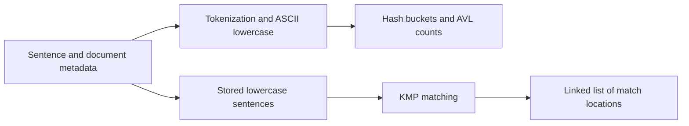

# Document Search Engine

A C++17 text-processing library combining a word-frequency dictionary with case-insensitive substring search. Built around a hash table, AVL trees, and Knuth–Morris–Pratt matching.

[](https://github.com/Himanshu-Singhal-compile/document-search-engine/actions/workflows/ci.yml)


## Features

- Count words across inserted sentences using 10,007 hash buckets with AVL-tree collision handling.
- Find overlapping substring matches, including matches inside words.
- Return book, page, paragraph, sentence, and zero-based byte offsets in a doubly linked result list.
- Export dictionary snapshots and build a standalone demonstration without external datasets.



## Build and run

Requires a C++17 compiler and CMake 3.16 or newer.

```sh
git clone https://github.com/Himanshu-Singhal-compile/document-search-engine.git
cd document-search-engine
cmake -S . -B build -DCMAKE_BUILD_TYPE=Debug
cmake --build build --config Debug
ctest --test-dir build -C Debug --output-on-failure
```

Run `./build/search_demo` on Linux/macOS or `build\Debug\search_demo.exe` with the Visual Studio generator on Windows. With MinGW the executable is usually `build\search_demo.exe`.

Direct GCC/MinGW build:

```sh
g++ -std=c++17 -I. dict.cpp search.cpp Node.cpp examples/demo.cpp -o search_demo
./search_demo
```

Expected demo: word count `2`, substring matches `2`, offsets `16` and `29`.

## API example

```cpp
#include "dict.h"
#include "search.h"

Dict dictionary;
dictionary.insert_sentence(1, 10, 2, 0, "Search, SEARCH!");
int frequency = dictionary.get_word_count("search"); // 2; use lowercase keys

SearchEngine engine;
engine.insert_sentence(1, 10, 2, 0, "banana");
int count = 0;
Node* matches = engine.search("ANA", count); // offsets 1 and 3
engine.free_results(matches);                // caller owns returned results
```

## Design and limitations

Dictionary insertion lowercases ASCII letters and splits on the punctuation listed in `Dict::insert_sentence`. Lookups expect normalized lowercase words. Unicode tokenization, stemming, and full-text ranking are outside the implementation. Search scans the stored corpus for each query: approximately O(pattern length + corpus length + matches); it is not an inverted index. AVL operations are O(log b) for b distinct words in a bucket. Dictionary export overwrites the destination and is sorted within each bucket, not globally.

`Dict`, `SymbolTable`, and `SearchEngine` own raw pointers and must not be copied. Results must be freed once with `free_results`. The implementation is intended for a single thread.

## Repository guide

| Path | Purpose |
| --- | --- |
| `dict.cpp`, `dict.h` | Hashing, tokenization, AVL counts |
| `search.cpp`, `search.h` | KMP search and sentence storage |
| `Node.cpp`, `Node.h` | Match metadata and links |
| `examples/demo.cpp` | Self-contained usage example |
| `tests/test_engine.cpp` | Regression checks, including randomized counts |
| `tester.cpp` | Legacy corpus harness; requires external `Input/` and `Output/` files |

The supported build excludes the legacy harness. Course PDFs and the external corpus are not redistributed. Packaging supplies the previously missing node constructors, initializes empty-search counts, and makes dictionary exports reproducible snapshots.


